# Plan: Improve holdout pass under fairness + do-no-harm

**Date:** 2026-08-03  
**Standard:** per seed vs paired no_op — `coll ≤` ∧ `G ≤` ∧ `loss ≤` (no +1.5 slack)  
**Baseline to beat:** i90 **30/50**; stretch i150 **33/50**  
**Current:** v9 `iter_40` **27/50**

---

## 1. Investigation findings

### 1.1 Scorecard

| Ckpt | pass | Δloss | ΔG |
|------|------|-------|----|
| v9 `iter_40` (~264k) | **27/50** | −3.08 | −2.25 |
| v3 `iter_90` | 30/50 | −2.82 | −2.92 |
| v8 `iter_150` | 33/50 | −3.48 | −3.06 |

### 1.2 Fail anatomy (v9)

- **G-only 7 / loss-only 4 / both 12 / coll 0** — fairness (alone or with delay) dominates.
- Fails are **easy no_op** seeds, not hard ones:
  - FAIL noop loss **20.4** vs PASS **26.0**
  - FAIL noop G **4.2** vs PASS **9.2**
  - **17/23** fails have noop G ≤ holdout median
- Shared structural fails (all three ckpts):  
  `106,117,119,120,129,136,137,143,146,147,148` — do not expect 50/50.
- v9 **regressed** on 11 seeds i90 passed; improved 8 — net worse (young from-scratch).

### 1.3 Mode-mix probe (`runs/probe/v9_mode_mix_pass_fail/`)

Easy-fail vs hard-pass (3+3 seeds): both ~**97% coast**. Failures are **not** recover/vacate spam; they come from **sparse** `fair_balance` / `protect` (~1%) that still flip easy seeds.

### 1.4 Critical mismatch: fair_balance legal before fairness pays

- Eligibility ([`env/actions.py`](../env/actions.py)): `|G| > fair_balance_gap_tau` (**0.05** absolute).
- Reward ([`env/rewards.py`](../env/rewards.py)): only penalizes `|G| − G_ref` with **G_ref ≈ 0.16** on holdout.

**Dead band** \(0.05 < |G| ≤ G_{\mathrm{ref}}\): `fair_balance` allowed, \(R_{\mathrm{fair}}=0\), delay/control can still fail the scorecard.

### 1.5 Train dynamics

`best/` stamped ~iter 1–5; later iters did not beat train reward → **selection signal ≠ scorecard**. Blind continue-to-900k is low EV.

```mermaid
flowchart TD
  easySeed["Easy no_op seed low G/loss"]
  deadBand["fair_balance legal while R_fair=0"]
  sparseAct["Sparse meter/protect"]
  scoreFail["Scorecard FAIL G or loss up"]
  easySeed --> deadBand --> sparseAct --> scoreFail
```

---

## 2. Objective

Maximize **holdout seed-pass** under the new gate. Means are secondary. Structural ceiling ~35–40/50 given the shared hard-fail club.

---

## 3. Phase 0 — Process freeze

1. Do not resume long train until Phase 1 lands.
2. Promote checkpoints by **holdout pass** only (ignore `policy_reward_mean` for release).
3. Reference bars: i90 30/50; stretch i150 33/50.

---

## 4. Phase 1 — Close eligibility / reward gap (highest confidence)

**Status: implemented** (in defaults + action engine; unit tests green).

### 4A. Relative `fair_balance` gate

In `_fair_balance_eligible`, require:

`|G| > stream_delay_gap_ref + fair_balance_gap_tau`

(wired via `set_stream_delay_gap_ref` from paired refs).

### 4B. Fairness mask

`shepherd_fairness_mask=True` for `fair_balance` only (threshold 0.1).

### 4C. Tests

- No eligibility when `|G| ≤ G_ref+τ`
- Eligibility when clearly above ref

**Success:** easy-fail pass ↑ without collapsing hard-pass seeds.

---

## 5. Phase 2 — Scorecard-aligned train (v9b)

**Status: training** — logdir `shepherd_fair_safe_v9b_dt05`, warm from v9 `iter_40`.

| Knob | Now | v9b |
|------|-----|-----|
| fair_balance gate | abs 0.05 | **relative to G_ref** |
| fairness_mask | off | **on** if Phase 1B helps |
| control_cost | 0.25 | keep or **0.30** |
| mode_use_bonus | 0.08 | **≤0.08** |
| delay_win | 0.30 | **0.20–0.25** |
| fairness / delay_budget | 1.20 / 1.10 | keep |

**Peek protocol (mandatory):** every ~10 iters / 60k steps, eval seeds **101–120** (20 seeds) under new gate; promote only if pass ↑; stop after 3 flat peeks.

Full 50-seed only for release candidates.

---

## 6. Phase 3 — Validation probes

1. **Coast oracle** on the 17 easy-fail seeds — if coast passes most, abstention is the right inductive bias.
2. Full holdout 101–150 under new gate.
3. Report secondary metric: pass excluding the 11-seed structural club.

---

## 7. Phase 4 — Only if still &lt;30/50

- Small fairness-win term (mirror `delay_win`), weight ≤0.2, only after masks/gates.
- Oversample low-`G_ref` / easy paired-pool episodes.
- No i90 warm-start (obs 121 vs 117).

---

## 8. Success criteria

| Milestone | Criterion |
|-----------|-----------|
| Phase 1 probe | Easy-fail band pass ↑; hard-pass not collapsed |
| v9b mid | Peek ≥12/20 on 101–120 |
| Release | Full holdout **≥30/50**; stretch **≥33/50** |
| Safety | Δcoll = 0 |

---

## 9. Anti-patterns

- Train to 900k on TB reward
- Raise `mode_use_bonus` / blanket protect
- Select on mean Δ while pass falls
- Target 50/50
