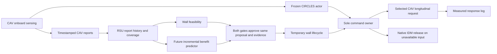

# Architecture

The fixed CIRCLES actor handles local damping. The RSU will decide whether a
specific temporary wall offers enough incremental benefit to justify assembly.
Only report interfaces and conservative diagnostic wall mechanics exist today;
no learned escalation predictor or accepted wall treatment is implemented.

The [test sequence](../archive/circles_era/docs/ESCALATION_TESTS.md) evaluates incremental benefit at any
traffic state. There is no unresolved-congestion or density entry condition.
The fixed damping baseline is characterized rather than optimized to pass an
independent superiority requirement. `escalation_study.py` registers bounded
native/damping jobs and captures opportunities; `escalation_evidence.py` scores
offline formation, paired effects and gate reliability. These are test tools,
not an implemented autonomous wall/predictor runner.

## Information and control flow

Evaluation observes the complete simulation to measure physical outcomes. This
is a separate offline channel: neither the actor nor the RSU feature buffer
receives global system time, true traffic count, HDV driver parameters, requested
demand, true CAV penetration or a privileged full-state shadow rollout.

## Sensing and RSU reports

[sensing.py](../traffic_shepherd/sensing.py) emulates ideal nearest front/rear
perception on the CAV's current lane, within 100 m and ending at lane boundaries.
It exposes bumper gaps and relative speeds, ego kinematics, localization/map
context, and observed front/rear coverage. The SUMO lane enumeration is the
sensor emulator, not a global feature feed. Occlusion across vehicles, sensor
noise, missed detections and communication delay effects are not yet validated.

The actor consumes only three fields: ego speed, reconstructed leader speed,
and bumper gap. Rear coverage remains part of the tested validity check; rear
kinematics do not enter the network or the removed tight projection. Missing,
stale, invalid or uncovered observations lead to native fallback.

[reporting.py](../traffic_shepherd/reporting.py) accepts timestamped self state
and onboard detections sent by CAVs. Receipt times, maximum age and history are
explicit. Empty report sets mean missing information, not an empty road. Neighbor
detections have reporter-local identity and are not silently deduplicated into
a full HDV census. Aggregate count is reporting CAVs, not total traffic; summed
sensor ranges are not road coverage union. Real sensor/noise/delay assumptions
must be registered before prediction claims.

## Per-CAV action set (current policy)

Per-CAV actions: native (release to plain IDM), damping (CIRCLES,
incumbent), and PI external-U. The wall (wall-v2) is a group action
over a selected CAV subset, still gated on feasibility and incremental
benefit. FollowerStopper is retired 2026-09-25 (owner decision) and is
no longer an action; its code path is removed and its CV-03..CV-06
evidence is historical only. The per-lane/per-cell mix layer
(spatial_assignment / spatial_pipeline / spatial_grid) is retired
2026-09-25 (WM-39): actions are chosen PER CAV and different CAVs may
run different actions at the same time; wall members are exclusively
owned by the wall session for the whole episode while non-members stay
free.

## Frozen controller and command owner

[damping.py](../traffic_shepherd/damping.py) verifies the permanent ONNX checksum
before inference. It passes float32 shape `(1,3)` in raw SI. The model embeds
normalization and the complete nonlinear rule wrapper. Multirow inference is
rejected because the export broadcasts batches incorrectly. `[0,0,0]` yields a
nonfinite model result and triggers native fallback.

The absolute model acceleration is bounded only by its tested [-3, +1.5] m/s²
interface and nonnegative/allowed-speed target. Each 1 s control tick sends
`slowDown(v + a*1s, 1s)`; SUMO advances in 0.5 s physics steps with speedMode31.
No approximate IDM acceleration is added. No extra jerk, front-gap or rear-gap
projection from the failed constrained adapter is applied.

[ownership.py](../traffic_shepherd/ownership.py) is the sole writer of longitudinal
requests. Only designated live CAVs may receive damping, wall or native ownership.
Native selection or unavailable input calls `setSpeed(-1)` if our override was
owned. The owner never commands HDVs or departed vehicles. Removing a wall
member returns it to the same controller instance; if perception is unavailable,
that controller requests native fallback. Safety flags and IDM vehicle types
are never replaced.

Telemetry separates actor input and model output, requested wall acceleration,
issued acceleration/target speed, owner/fallback/release, and measured speed and
acceleration at each physics tick. An issued acceleration is a command target,
not the measured response or a hard physical safety bound.

## Wall and escalation boundary

[formation.py](../archive/circles_era/traffic_shepherd/formation.py) is the current longitudinal
formation treatment. Position error relative to the cohort centre changes each
member's desired speed; speed error produces an absolute acceleration. Initial
separation is distinct from the50m final compactness definition. There are no
wall lane-change commands. Controlled SUMO supports10–150m assembly in the
declared clear-road cases; natural feasibility is still an empirical question.

Admission distinguishes missing members, missing information, unsafe local
geometry and short runway. Report-based assembly/runway estimates are logged
as conditional estimates, not guaranteed delivery. Every command requires
current local execution evidence from each CAV's numerical damping decision
or explicit native fallback: a cached RSU report alone cannot authorize it.
Current lane/report/member loss aborts the whole cohort.

Three consecutive1s target-settled observations start HOLD. The independent
[formation scorer](../archive/circles_era/traffic_shepherd/formation_evidence.py) checks every0.5s
HOLD boundary and actual ownership at handback. Normal taper blends toward the
identical CIRCLES commands. A valid native fallback triggers explicit whole-wall
release; missing execution evidence aborts. No native acceleration is invented.
The lifecycle emits an acceleration map and cannot write TraCI itself.

[paired_experiments.py](../archive/circles_era/traffic_shepherd/paired_experiments.py) uses explicit
registered assignment for development labels. It matches predecision measured
state, received reports/history, commands and exogenous requests; simulator
state is confined to offline evidence. It supports continued damping, wall,
sham and assembly-only arms at a common service horizon, retaining failed attempts.

[proposal_features.py](../archive/circles_era/traffic_shepherd/proposal_features.py) accepts received
CAV packets only, retains receipt/observation age and missingness, and binds the
finite feature vector to its exact proposal. Coverage is per reporter, never an
assumed union or full HDV census. No true penetration, density or global health
is a feature. No congestion prerequisite is imposed on proposal consideration.

[escalation_policy.py](../archive/circles_era/traffic_shepherd/escalation_policy.py) implements one
active wall, repeated opportunities, cooldown and fresh approvals from both
frozen gates. It defaults to abstention because no scientifically qualified
gate bundle is supplied. Its artifact checks enforce schema/hash/numerical
consistency; independent physical and statistical audits remain necessary.
The older compact-only [wall.py](../archive/circles_era/traffic_shepherd/wall.py) is a retained
diagnostic interface, not the current physical treatment or a trained gate.

Historical analytical/sustained/multiwall code and its full tests remain in the
archive. Their memberships, safety and release regression intent informed the
small active interface, but their unvalidated controllers, global health inputs
and historical predictor labels are not active dependencies.

## Scenarios and physical evaluation

[scenarios.py](../traffic_shepherd/scenarios.py) preserves explicit Poisson
requests, routes, IDM driver mix and fixed `speedDev=0`. CAV designation is a
nested independent identity draw: changing penetration changes controllable
vehicles, not the exogenous request/type sequence. The tested fixture uses
2,400 s episodes, 1,800 s demand, ramp 400 veh/h and piecewise mainline decline.
[seeds.py](../traffic_shepherd/seeds.py) retains historical exclusion partitions
and rejects sealed or unregistered cases at the execution boundary.

[workflow.py](../traffic_shepherd/workflow.py) runs one explicit native/damping
case, writes immutable identities and separate telemetry, and rejects existing
outputs. [metrics.py](../traffic_shepherd/metrics.py) records:

- Severe braking: vehicle-seconds with measured acceleration below -3 m/s².
- Acceleration effort: sum of integrated squared measured acceleration,
  in vehicle·m²/s³; this is a smoothness/effort proxy, not fuel energy.
- Total requested service: request-to-arrival vehicle-seconds, including source
  waiting, divided by all exogenous requested vehicles. Unfinished work is reported.
- Source waiting separately; short-TTC exposure below 3 s in vehicle-seconds,
  minimum closing TTC, collision involvements and starting teleports.

All comparisons must pair demand, driver types, seeds, horizon and physical
definitions. Matched native/damping outcomes are offline evidence only. Short
checks retain the full requested-population denominator and label future/due
requests separately; they cannot establish full-episode performance.
