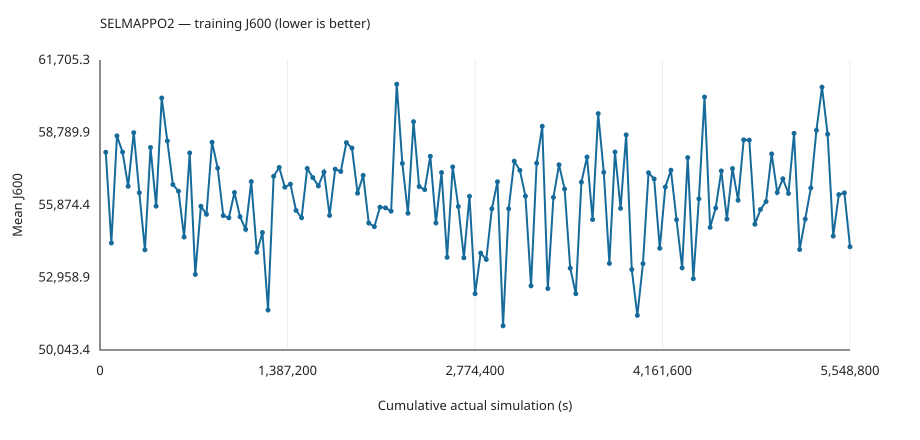

# SELMAPPO2 results

**Training status: PARTIAL**

Evidence: `selmappo2/COLLECTION_c141d5715f26af4e9b50d0866cdf971ef92d55dd1223c4312c4f25bdec5a8b29_1793516493919938700_b76a810f9cf2499b98dcd05791d18ae7.json`; SHA256 `b66945abaa5c99dfadca7501a1e3bc030b03683d78bc34b3cd49c96014ec52db`.

Remote root: `/home/ubuntu/selmappo2_20261101/build_c141d5715f26af4e9b50d0866cdf971ef92d55dd1223c4312c4f25bdec5a8b29/training`.

Dispatch PID: `606968`; alive at observation: `True`; observation timestamp (ns): `1793516489902487015`.

## Training progress

Verified complete updates: 134/169 (46 fresh episodes/update).

Update records observed: 134.

Coordinator successful episodes: 6179/7,774 production + 1/2 smoke.

Reservations: 6193; unresolved: 12; failed: 1; actual not yet receipted: 12.

Raw newly incurred training + smoke simulation: 5,562,300.0 actual s; 5,573,700 reserved s (no refunds).

Full planned production simulation: 6,996,600 s; smoke: 1,800 s; total training + smoke: 6,998,400 s. The separate 16-world evaluation would cost 14,400 s (combined allocation 7,012,800 s).

Inherited controller-library training and world-model (WM) costs: unknown; excluded from raw new-run simulation, not assumed zero.

Reported simulation includes 300 s native warmup + 600 s control per episode.

Wall times in the curve CSV are measured per-update coordinator wall times; they are not CPU-hours or inherited training costs.

## Learning curve

J600 is full-team delay over the 600 s control interval; lower is better. Each point uses a verified complete 46-episode update. The x-axis is cumulative actual simulation seconds, including two smoke episodes and warmup. Fresh scheduled worlds vary between updates; this is training progress, not an efficacy comparison or checkpoint-selection rule.

[Complete-update metrics CSV](selmappo2_curve_1793516494646894700_a1dea9aa04dd4607a9e71c6f61d3d4cb.csv)

## Safety receipts

Collected complete episode result receipts: 6181. collisions: 0.000; teleports: 0.000; ttc_below_3_vs: 2,564,122.000; hard_brake_vs: 99,293.500.

These are recorded control-interval components only. Warmup safety and dropped-vehicle counters are not separately recorded in result.jsonl; unrecorded metrics are not asserted to be zero.

## Frozen final169

Final169 manifest/checkpoint hash not yet verified.

## Evaluation

**PENDING** — peer-owned S-C1SWITCH2 panel seeds 969136..969151. No byte-pinned complete evaluation JSON has been supplied. No final efficacy claim can be made from training progress.

## Evidence limitations

- Acknowledged historical smoke failure retained: 900 reserved / 300 actual s.
