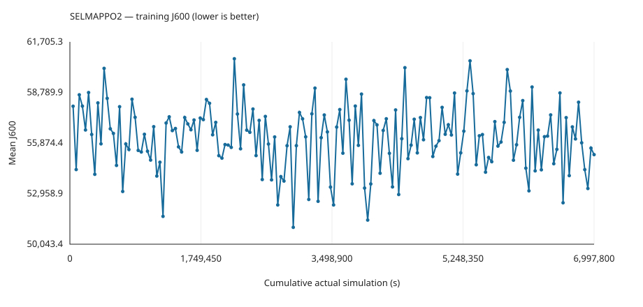

# SELMAPPO2 results

**Training status: COMPLETE**

Evidence: `selmappo2/COLLECTION_c141d5715f26af4e9b50d0866cdf971ef92d55dd1223c4312c4f25bdec5a8b29_1793525084353376800_1c382a5072b74e3fb0080392b1c9f416.json`; SHA256 `a8a08f8c30279c1473b78421d740332e2ef158f3ad117ad8839851723e1de8c0`.

Remote root: `/home/ubuntu/selmappo2_20261101/build_c141d5715f26af4e9b50d0866cdf971ef92d55dd1223c4312c4f25bdec5a8b29/training`.

Dispatch PID: `606968`; alive at observation: `False`; observation timestamp (ns): `1793525079125782565`.

## Training progress

Verified complete updates: 169/169 (46 fresh episodes/update).

Update records observed: 169.

Coordinator successful episodes: 7774/7,774 production + 1/2 smoke.

Reservations: 7776; unresolved: 0; failed: 1; actual not yet receipted: 0.

Raw newly incurred training + smoke simulation: 6,997,800.0 actual s; 6,998,400 reserved s (no refunds).

Full planned production simulation: 6,996,600 s; smoke: 1,800 s; total training + smoke: 6,998,400 s. The separate 16-world evaluation would cost 14,400 s (combined allocation 7,012,800 s).

Inherited controller-library training and world-model (WM) costs: unknown; excluded from raw new-run simulation, not assumed zero.

Reported simulation includes 300 s native warmup + 600 s control per episode.

Wall times in the curve CSV are measured per-update coordinator wall times; they are not CPU-hours or inherited training costs.

## Learning curve

J600 is full-team delay over the 600 s control interval; lower is better. Each point uses a verified complete 46-episode update. The x-axis is cumulative actual simulation seconds, including two smoke episodes and warmup. Fresh scheduled worlds vary between updates; this is training progress, not an efficacy comparison or checkpoint-selection rule.

[Complete-update metrics CSV](selmappo2_curve_1793525685693763800_e012fbd45d9d4017b956d8040f57388c.csv)

## Safety receipts

Collected complete episode result receipts: 7775. collisions: 0.000; teleports: 0.000; ttc_below_3_vs: 3,234,677.000; hard_brake_vs: 125,921.500.

These are recorded control-interval components only. Warmup safety and dropped-vehicle counters are not separately recorded in result.jsonl; unrecorded metrics are not asserted to be zero.

## Frozen final169

Verified checkpoint SHA256: `82c6745bac50aaf4dee98f5d8b3c60db0e5e558d9abf4667dd8e605774f4b3c4`.

## Evaluation

**PENDING** — peer-owned S-C1SWITCH2 panel seeds 969136..969151. No byte-pinned complete evaluation JSON has been supplied. No final efficacy claim can be made from training progress.

## Evidence limitations

- Acknowledged historical smoke failure retained: 900 reserved / 300 actual s.
